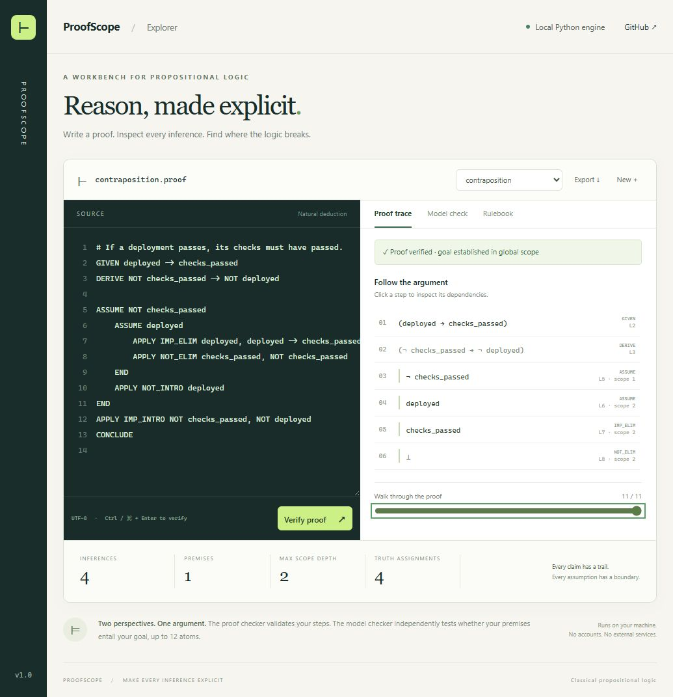
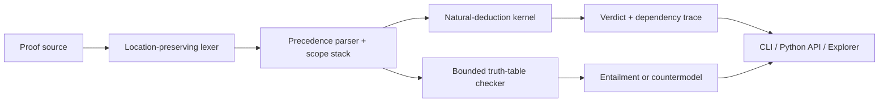

<div align="center">

# ⊢ ProofScope

**Make every inference explicit.**

A Python toolkit for propositional proof verification, scope-aware inference tracing,
and countermodel analysis. Includes a local, interactive proof explorer.

[](https://github.com/joshbeira/proofscope/actions/workflows/ci.yml)


[](LICENSE)

[Quick start](#quick-start) · [Language reference](docs/language.md) · [Architecture](docs/architecture.md) · [Python API](docs/api.md)

</div>



## From a claim to a checkable argument

An implication can look convincing while quietly depending on an assumption that no longer holds.
ProofScope makes those dependencies visible. Write a proof, verify each inference, and inspect exactly
which earlier steps justify the result. Then check the underlying sequent independently against all
truth assignments within a configured atom limit.

The two checks answer different questions:

- **Proof verification:** is every submitted step justified, and is the goal established in global scope?
- **Semantic analysis:** do the premises entail the goal, or is there an assignment that refutes it?

A valid sequent can still have an invalid proof. The explorer shows both results without conflating them.

## Highlights

- **12 inference rules:** conjunction, disjunction, implication, negation, proof by cases, explicit
  double-negation elimination, explosion, and reiteration.
- **Nested syntax trees:** compound assumptions, parentheses, precedence, and word/ASCII/Unicode operators.
- **Strict scope boundaries:** unique scope identities, closed-subproof snapshots, and discharge only
  into the correct parent scope. No mutable global proof state.
- **Explainable execution:** source locations, dependency edges, a trace scrubber, and actionable diagnostics.
- **Countermodel search:** exhaustive classical entailment checking up to 12 atoms by default,
  with explicit reporting of inconsistent premises and resource limits.
- **Three interfaces, one engine:** installable Python API, scriptable CLI with JSON output, and a browser explorer.
- **Offline runtime:** Python's standard library powers the engine and local server. No database,
  account, external API, or frontend build step.

## Quick start

Requires **Python 3.11 or newer** and Git. No package has been published to PyPI; install from this repository.

```bash
git clone https://github.com/joshbeira/proofscope.git
cd proofscope
python -m venv .venv
```

Activate the environment:

```bash
# macOS / Linux
source .venv/bin/activate

# Windows PowerShell
.venv\Scripts\Activate.ps1
```

Install and open the explorer:

```bash
python -m pip install -e .
proofscope serve --open
```

The explorer runs at **http://127.0.0.1:8765**. Choose an example, edit the proof, and press
**Ctrl/⌘ + Enter**. Click a trace step to highlight its dependencies, scrub through the argument,
or switch to **Model check** to inspect truth assignments. Proof source is saved in your browser's
local storage; **Export** downloads a `.proof` file. Invalid examples are included deliberately.

`python -m proofscope` works anywhere the `proofscope` command does.

## A proof you can run

This proof derives contraposition from an implication:

```text
GIVEN deployed -> checks_passed
DERIVE NOT checks_passed -> NOT deployed

ASSUME NOT checks_passed
    ASSUME deployed
        APPLY IMP_ELIM deployed, deployed -> checks_passed
        APPLY NOT_ELIM checks_passed, NOT checks_passed
    END
    APPLY NOT_INTRO deployed
END
APPLY IMP_INTRO NOT checks_passed, NOT deployed
CONCLUDE
```

```bash
proofscope check src/proofscope/examples/02-contraposition.proof --trace --semantic
```

```text
VALID src/proofscope/examples/02-contraposition.proof | 4 inferences | goal: (NOT checks_passed IMP NOT deployed)
```

The `END` statements close local assumptions. `NOT_INTRO` and `IMP_INTRO` discharge those
subproofs into their actual parent scopes, preserving the logical context of every conclusion.

## Find a counterexample

The converse of an implication is not generally valid:

```bash
proofscope entails "cached" --given "cached -> fast" --given "fast"
```

```text
COUNTERMODEL: cached=false, fast=true
```

This assignment satisfies both premises while falsifying the goal.

## Use it in scripts

```bash
# A JSON array, one result per input file
proofscope check first.proof second.proof --json --semantic

# Read from standard input
proofscope check - --json

# List rules and their argument counts
proofscope rules
```

Exit codes: **0** = valid proof / entailed sequent; **1** = rejected proof / countermodel;
**2** = input, usage, or resource error. For `check`, source-level diagnostics (including source
resource limits) are rejected proofs and return **1**. `--semantic` adds an independent result;
it does not change the proof verdict or exit code.

```python
from proofscope import analyze, verify

result = verify("""
GIVEN authenticated
GIVEN authenticated -> access_granted
DERIVE access_granted
APPLY IMP_ELIM authenticated, authenticated -> access_granted
CONCLUDE
""")

assert result.valid
print(result.to_dict())

model = analyze(["A -> B", "B"], "A")
assert model["countermodel"] == {"A": False, "B": True}
```

## Inside the engine



```text
src/proofscope/
├── formula.py       Immutable formula trees and classical evaluation
├── lexer.py         Tokens with original line and column positions
├── parser.py        Formula precedence and proof structure
├── verifier.py      Inference rules, scope identities, evidence traces
├── semantics.py     Bounded exhaustive model checking
├── diagnostics.py   Stable error codes and source excerpts
├── cli.py           Batch checking, JSON output, and exit codes
├── server.py        Loopback HTTP adapter
├── examples/        Valid proofs and intentional failure cases
└── web/             Browser explorer; no build tooling required
tests/               Unit, regression, semantic, CLI, and HTTP tests
docs/                Language, architecture, API, and design decisions
```

Read the [architecture notes](docs/architecture.md) for scope invariants, complexity, and the
trust boundary, or the [language reference](docs/language.md) for exact rule semantics.

## Development

```bash
python -m pip install -e ".[dev]"
python -m unittest discover -s tests -v
python -m ruff check .
python -m ruff format --check .
python -m coverage run -m unittest discover -s tests
python -m coverage combine
python -m coverage report
python -m build
```

Tests exercise every inference rule, invalid arguments, malformed input, nested scope escapes,
repeated assumptions, concurrent isolation, CLI contracts, HTTP boundaries, and finite semantic
cross-checks. The single-step regression generator checks **576 rule instances** against exhaustive
truth assignments. These finite checks are evidence against regressions, not a formal proof of
the implementation's soundness.

CI runs the test suite across multiple Python versions and Windows/Linux, checks formatting and
lint, and builds and smoke-tests the distributable wheel. See [CONTRIBUTING.md](CONTRIBUTING.md).

## Scope and limits

ProofScope verifies user-written proofs in **classical propositional logic**. It does not synthesize
proofs, handle quantifiers, or act as a SAT/SMT solver. Formula equality is structural: commutativity
and double negation require explicit inference steps. `OR_ELIM` is disjunctive syllogism;
`OR_CASES` is elimination by cases.

Semantic analysis takes exponential time in the number of distinct atoms. The default is 12 atoms
(4,096 assignments); the CLI/API allow a maximum of 16. Larger inputs receive an explicit `limit`
result. Source length, formula size, token count, and scope depth are also bounded.

The browser server binds only to loopback and is intended for local use. It does not execute proof
source as Python, accept file paths through the API, or provide a production hosting service.

## License

[MIT](LICENSE) · Josh Beira
